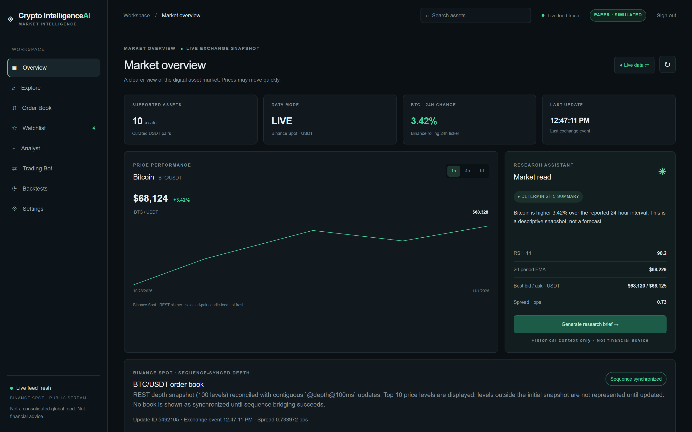
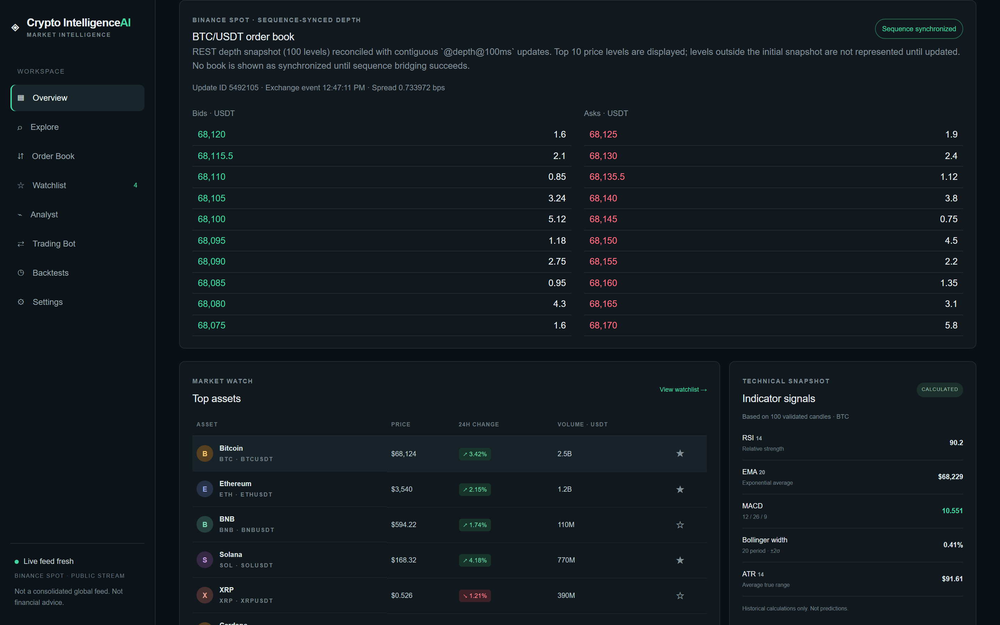
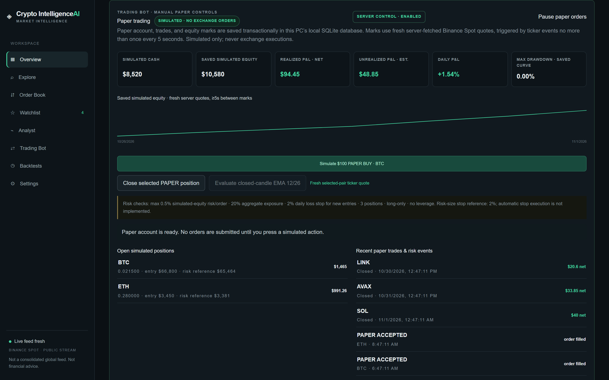
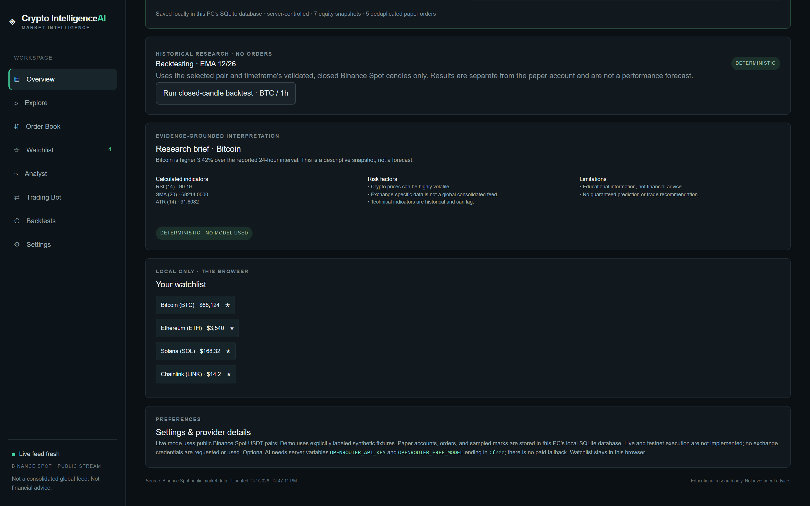

# Crypto Intelligence AI

A local, single-user cryptocurrency research workspace with clearly labeled demo fixtures, Binance Spot market data, deterministic technical indicators and an optional free-only AI explanation. Manual paper trades are simulated only. **This app has no testnet or live exchange execution.** It is not investment advice.

Repository: https://github.com/0xyz-exe/crypto-intelligence-ai

## Screenshots

### Market Intelligence Dashboard


### Deterministic Technical Analysis & Charts


### Simulated Paper Trading & Equity Curve


### AI Market Summaries & Indicator Insights


## Requirements

- Node.js 22 or newer (verified here with Node 26.7.0) and npm.
- No API key is needed for Demo mode, live public market data, deterministic analysis, authentication, or paper simulation.

## Run locally on Windows

In Windows Terminal, from this repository folder:

```powershell
npm ci
npm run dev -- --hostname 127.0.0.1
```

Open <http://127.0.0.1:3000>. The first visit asks you to create a local password (12–128 characters); later visits ask you to sign in. The password is stored as a salted server-side hash. Sessions are HttpOnly and expire after seven days. Sign out from the workspace header. There is no online account or password-recovery service, so keep your password safely.

The dashboard starts in explicitly synthetic Demo mode. Switch to **Live data** to request public Binance Spot market data. If the exchange/network is unavailable, the app shows an error or stale state; it does not silently substitute demo data. Paper order buttons require a fresh live ticker quote and remain disabled in Demo mode.

### Local storage and privacy

The default SQLite database path on Windows is `%LOCALAPPDATA%\CryptoIntelligenceAI\app.sqlite`. It contains the local password hash, hashed sessions, paper account, sampled equity marks, paper-order results, and trading-control state. The application creates the directory on first access. Use a restrictive Windows account and keep the PC login protected. To choose another absolute data directory, set `CIA_DATA_DIR` before starting the app, for example:

```powershell
$env:CIA_DATA_DIR = 'D:\CryptoIntelligenceAI'
npm run dev -- --hostname 127.0.0.1
```

The watchlist is stored separately in this browser's local storage. No exchange account password, API key, seed phrase, or private wallet key is requested. Public market data goes to Binance Spot. Optional AI requests use the separately configured OpenRouter key only if you choose to add one.

### Commands

```bash
npm run dev          # local development
npm run lint         # ESLint
npm run typecheck    # strict TypeScript
npm test             # deterministic unit tests
npm run test:e2e     # Playwright Chromium workflow tests
npm run build        # production build
npm run start -- --hostname 127.0.0.1  # production build on loopback
npm audit            # dependency audit
```

## Paper trading boundaries

- **Simulation only:** paper balances, fills, and trades are not exchange activity and do not represent real funds.
- Paper account state, orders, and marks persist in local SQLite on this PC. State changes are performed server-side and transactionally; duplicate order IDs are idempotent; ownership and the persisted server kill switch are checked server-side.
- Paper buy/close actions are manual and require a fresh quote fetched by the server from an allowlisted Binance Spot REST endpoint. The browser does not submit prices or account state.
- Open positions are marked from fresh server quotes at most once every five seconds. Equity is sampled, not continuous tick-by-tick accounting, and is not a reconciled financial ledger. The displayed unrealized P&L is an estimate from fresh browser ticker data.
- The app is single-user/local. Its database is not an independently backed-up or tamper-evident audit ledger.
- Testnet order execution and live execution are both **unimplemented and disabled**. No exchange trading credentials are used. Do not interpret the kill switch as authorization or readiness for exchange execution.

## Optional free-only AI

Copy `.env.example` to `.env.local`, then set an application-owned OpenRouter key and an available model identifier ending exactly in `:free`:

```dotenv
OPENROUTER_API_KEY=your-separate-app-key
OPENROUTER_FREE_MODEL=vendor/model:free
```

No Hermes credentials are read or copied. Without either variable, the API returns a labeled deterministic report. If the model is unavailable or invalid, deterministic analysis remains; no paid fallback is attempted. OpenRouter free-model availability/quotas change; verify the current model catalog, pricing and limits before use. Do not expose the key to client code.

## Local inference

Not enabled. Ollama did not connect to a running daemon during the environment audit. No runtime or model weights were installed/downloaded. No model is required to use this app.

## Data and research limitations

- Live prices and depth are Binance Spot-specific USDT data, not a consolidated worldwide market price. Exchange/network availability and rate limits vary. Volume is quote-asset USDT volume; market capitalization is not available from this provider and is not inferred.
- The displayed order book is a sequence-synchronized partial snapshot (100 REST levels, top 10 displayed), not an execution-grade complete book.
- Demo figures are synthetic fixtures, not historical market observations.
- Technical indicators and strategy signals describe historical observations; they are not forecasts or autonomous order instructions.
- Backtests use supplied candles and modeled fees/slippage; results are not forecasts or guarantees.
- Before public or commercial redistribution, review current provider terms, privacy needs, hosting exposure, and operational costs. This project is local-only and is not certified for production deployment.

## Project map

- `src/app/workspace.tsx` — dashboard, market controls, paper-account sync, server kill-switch UI and research panels.
- `src/app/auth-screen.tsx`, `src/app/page.tsx` — local account setup/login and authenticated workspace gate.
- `src/app/api/` — authenticated market, history, analysis, paper-account, paper-order and trading-control routes.
- `src/lib/server/` — local SQLite database, password/session handling and transactional paper service.
- `src/lib/market-data/` — Binance Spot provider, symbol allowlist, stream parser and partial order-book synchronizer.
- `src/lib/trading/` — bounded paper simulation, deterministic signals and backtesting.
- `tests/e2e/` — onboarding, authentication, responsive UI and controlled market-stream workflows.
- `docs/` — architecture, provider, security and testing notes.

## Development notes

The project uses ESLint with `typescript-eslint` and validates the Next.js production build and strict TypeScript separately. Dependency advisories should be rechecked after package changes; the current `npm audit --audit-level=high` reported zero vulnerabilities.