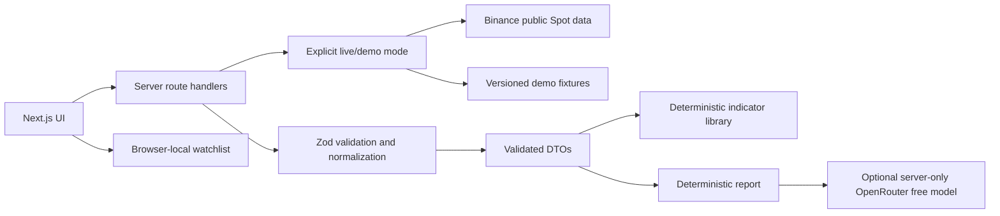

# Architecture

## System shape

## Responsibilities and boundaries

- `src/app`: pages, layout, route handlers and styling.
- `src/lib/market-data`: whitelisted symbols, provider adapter, normalization, freshness and fixture selection.
- `src/lib/indicators`: pure deterministic calculations; no network or AI.
- `src/lib/ai`: analysis schema, deterministic fallback and optional model client. API key is server-only, never sent to client.
- Browser storage contains only user's local watchlist preferences, not credentials.

## Data flow and errors

UI asks same-origin route handlers for normalized DTOs. Route validates query parameters against fixed supported symbols/timeframes. Provider URL host is constant; user strings never choose a hostname or path. Provider JSON is schema checked before use. Requests have deadlines and bounded retry; errors map to safe actionable messages, no provider body/key exposure. Fixture mode is selected explicitly and labeled. Live failure returns an error; it never injects demo content.

## Caching and decisions

Keep requests server-side and use short, bounded revalidation suitable for a public snapshot. Never cache AI credentials or user-specific content. Asset markets are one public snapshot; historical series are keyed by symbol and interval. Deterministic computations operate over normalized validated closes.

## Trade-offs

A single Next.js app avoids paid infrastructure and unnecessary services. Binance provides unauthenticated public exchange-specific data; it is not a global consolidated market feed and may be regionally inaccessible. Local watchlists avoid accounts. AI is an opt-in integration only and is not required for core analysis.
